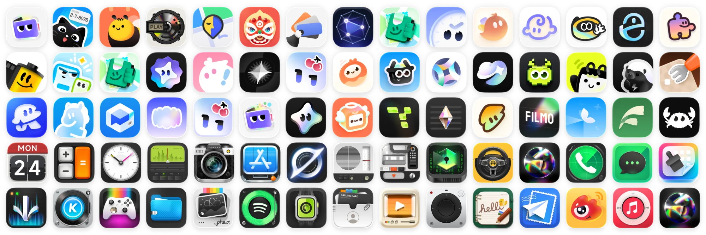

## Hi, I'm Kubai (@枯白啃设计)

Product designer. I draw app icons, build small, well-made tools, and share design tips for vibe-coded apps.

 

[kubai.design](https://www.kubai.design/) · [i@kubai.design](mailto:i@kubai.design)
