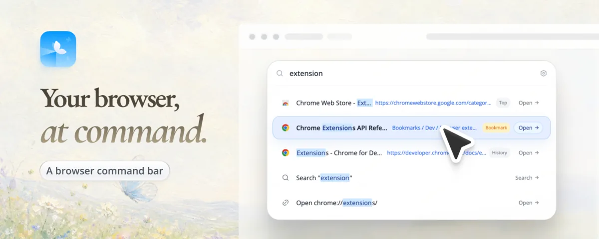

## Hi, I'm Kubai

Product designer. I draw app icons, and I build the tools I want to use every day.

我是枯白，画 App 图标，也写自己每天想用的小工具。

<!--
Icon showcase: drop 4 or 6 square PNGs (512px or larger) into assets/icons/ and uncomment.

  
  
  
  
  
  

-->

### Lumno

A free, open-source command bar and new tab for Chrome, Edge and Firefox. One shortcut to search your open tabs, bookmarks and history from any page.

[Chrome Web Store](https://chromewebstore.google.com/detail/nggfkkbmogmadfoikakkfegkoilfcfao) · [Edge Add-ons](https://microsoftedge.microsoft.com/addons/detail/pfbklkaefmfamjpibfiapaiihlddhchc) · [Firefox Add-ons](https://addons.mozilla.org/firefox/addon/lumno-command-bar-new-tab/) · [Website](https://lumno.kubai.design/) · [Source](https://github.com/kubai087/lumno-extension)

### Elsewhere

[kubai.design](https://www.kubai.design/) · [X](https://x.com/Kubai087) · [小红书](https://www.xiaohongshu.com/user/profile/5f30130300000000010006eb) (icon work and tutorials) · [i@kubai.design](mailto:i@kubai.design)
